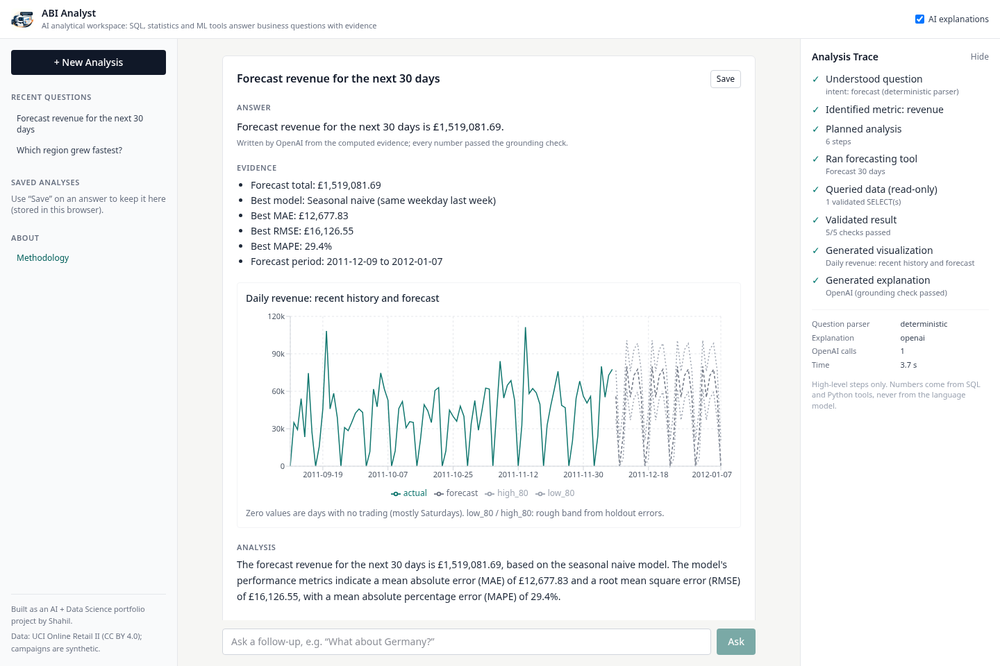

<div align="center">


# Autonomous Business Intelligence Analyst

### Ask questions about your business data. Get evidence-backed answers.


</div>

## Live Demo

**https://autonomous-bi-analyst.vercel.app**

Type a question such as "Which region grew fastest?" or pick one of the suggested questions. No sign-up is needed.

## What it does

ABI Analyst is an analytical workspace for two years of online-retail sales. You ask a business question in plain
English. The backend turns it into a validated analysis plan, runs SQL and Python tools on a read-only DuckDB
database, checks the results, and returns:

- a short answer and the evidence behind it,
- a chart built from the result rows,
- the exact SQL that ran, the data, the method and the limitations,
- a high-level trace of the steps taken.

The language model never computes a number. SQL, statistics and ML code compute everything; OpenAI only parses
unclear questions and words the explanation, and every number it writes is checked against the evidence.

## Why I built it

Most "chat with your data" demos let a model write SQL and describe the result, and it is hard to tell when the
numbers are wrong. I wanted to build the opposite: an analyst where every number comes from code I can test, the
statistics report their assumptions, and the model only writes sentences around evidence that has already been
checked.

My first project, [Market Intelligence Lab](https://github.com/shahil5z/market-intelligence-lab), covers classical
data science (modelling and evaluation in notebooks and a dashboard). This one is about agentic analytics: tools,
planning, validation and grounded AI explanations.

## Core workflow

```
USER QUESTION
      ↓
QUESTION ANALYZER      rules first, OpenAI structured parse only if unsure
      ↓
ANALYSIS PLANNER       typed plan of tool calls, built in code
      ↓
TOOL ROUTER            calls registered tools only (no shell, files or code execution)
      ↓
SQL / STATISTICS / ML / FORECASTING TOOLS
      ↓
RESULT VALIDATOR       non-empty, finite, totals reconcile, periods in range
      ↓
EVIDENCE OBJECT        headline numbers, rows, SQL, periods, limitations
      ↓
OPENAI                 writes a draft explanation from the evidence only
      ↓
GROUNDED EXPLANATION   numbers, names and causal wording checked; else template
      ↓
USER
```

## Key capabilities

- Revenue rankings, totals and top-N products with shares.
- Period-over-period growth, change decomposition and growth drivers.
- Monthly trends and 7 to 90 day revenue forecasts with a rough uncertainty band.
- Anomaly detection with a drill-down by region, product and order.
- RFM customer segmentation with K-Means.
- Two-group significance tests, chi-square association and price-quantity correlation.
- Synthetic campaign comparisons, worded as association only.
- Follow-up questions in the same session ("What products drove that growth?", "What about Germany?").
- A no-answer mode for questions the data cannot answer (weather, personal data, unknown columns, 2-year forecasts)
  and a refusal for instructions to change data or ignore rules.
- A methodology page that explains each method.

## Tech Stack

- **Frontend:** Next.js 16, React 19, TypeScript, Tailwind CSS 4, Recharts
- **Backend:** Python 3.13, FastAPI, Pydantic 2, SQLite (run records)
- **Data & Analytics:** DuckDB (read-only), pandas, NumPy, SciPy, scikit-learn
- **AI:** OpenAI Python SDK, `gpt-4o-mini` with structured outputs
- **Security & Validation:** sqlglot (SQL parsing and allowlists), Pydantic schemas, a custom grounding check,
  per-IP rate limits
- **Testing:** pytest, Ruff, ESLint, TypeScript compiler (`tsc --noEmit`), a 20-question evaluation script
- **Deployment:** Vercel (frontend and backend as two projects)

## Data

[UCI Online Retail II](https://archive.ics.uci.edu/dataset/502/online+retail+ii) (Chen, 2019), licence CC BY 4.0:
1,067,371 invoice lines from a UK online gift retailer, 2009-12-01 to 2011-12-09. After cleaning, 1,003,214 sales
lines remain.

- Regions and product categories are derived by rules.
- Campaigns are **synthetic** (seed 42, no effect injected), so campaign answers only demonstrate the method.
- The raw file is not committed. `scripts/run_pipeline.py` downloads it and builds the database. A 2,000-row raw
  sample is in `data/sample/`.
- Lineage: raw XLSX → `scripts/ingest.py` (cleaning, cancellations split out) → `scripts/build_db.py` (DuckDB star
  schema: `sales`, `products`, `customers`, `regions`, `calendar`, `campaigns`, `cancellations`) →
  `backend/artifacts/abi.duckdb.gz` (about 6 MB, committed so the deployed backend has the same data).
- Data dictionary: [data/README.md](data/README.md).

## Analytical methods

- **Growth:** period-over-period change with a small-base flag (groups under 1% of the comparison total are not
  ranked) and a change decomposition.
- **Significance tests:** Shapiro-Wilk and Levene are checked first, then Student t, Welch t or Mann-Whitney U is
  chosen. Answers report n per group, the statistic, the p-value, a 95% CI for the difference and Cohen's d.
  Example: Germany vs France mean order value £509.02 vs £520.22, Welch p = 0.771, not significant.
- **Association and correlation:** chi-square with Cramér's V; Pearson on log-log values with a Fisher CI, plus
  Spearman.
- **Forecasting:** daily revenue, the last *h* days held out (time split). Seasonal naive (same weekday last week),
  4-week weekday mean and ridge regression (trend + weekday + annual Fourier terms) are compared on MAE, RMSE and
  MAPE (trading days only). If nothing beats the baseline, the baseline is used and the app says so. On the 30-day
  holdout (2011-11-09 to 2011-12-08): seasonal naive MAE £12,677.83, RMSE £16,126.55, MAPE 29.4%; weekday mean MAE
  £13,339.83; ridge MAE £16,022.30. The 80% band comes from the 10th/90th percentiles of holdout errors and is a
  rough guide, not a calibrated interval.
- **Segmentation:** RFM per customer → log1p + standardisation → K-Means for k = 2 to 6, k chosen by silhouette.
  Result: k = 2, silhouette 0.418, 5,852 customers; the top segment holds 45.9% of customers and 90.5% of revenue.
- **Anomalies:** daily revenue vs the median of the previous 28 trading days, robust z-score (median / MAD) above
  3.5, with an IQR cross-check. Largest: 2011-12-09, £198,094.64.

## AI / Agent workflow

The tools compute the numbers; the LLM only explains validated evidence.

- **Parsing:** a deterministic parser handles known question shapes. OpenAI structured output (a fixed Pydantic
  schema) is used only when the parser is not confident, and the result is checked against known intents, metrics
  and entity names.
- **Evidence object:** the explanation model receives headline numbers, a few supporting rows, periods and
  limitations, not raw tables.
- **SQL visibility:** every answer has a "View SQL" tab with the exact queries that ran, plus "View Data" and
  "View Method" tabs and a data lineage line.
- **Validation:** results must be non-empty and finite, group totals must match an independent total, and periods
  must be inside the data range.
- **Grounding:** a draft is accepted only if every number matches the evidence (with rounding tolerance), product
  names are copied exactly and there is no causal wording. Otherwise a deterministic template is used and the
  answer says so.
- **Fallback:** without a key, with an invalid key, or on an OpenAI error or timeout, the app still answers with
  the template explanation, labelled in the UI.
- At most two OpenAI calls per question (temperature 0, token caps, 12 s timeout, one retry). The trace shows
  high-level steps only, not model reasoning.

## Security & SQL safety

- **SQL:** the LLM never writes SQL. Queries are built from a typed spec and pass one `validate_sql` gate: a single
  statement parsed with sqlglot, `SELECT` only, a keyword blocklist, table and column allowlists, no
  schema-qualified names or table functions, a function blocklist and a LIMIT capped at 500 rows.
- **Database:** DuckDB is opened read-only with external access disabled and a locked configuration. Queries are
  interrupted after 10 s.
- **Prompt injection:** questions asking to ignore instructions or change data are refused. Database text (product,
  country, region and campaign names) is passed to the model as data with a rule to ignore instructions in it, and
  numbers that appear only inside data strings do not count as evidence. Tests plant an injection in DB fields and
  check that the answer is unchanged.
- **Abuse limits:** per-IP limits on `POST /api/analyze` (10 per minute, 150 per day), 500-character questions,
  4 KB request bodies and OpenAI token caps.
- **Secrets:** the OpenAI key stays on the backend, is never sent to the browser and is never logged. CORS allows
  only the frontend origin.

## Evaluation

`scripts/run_eval.py` runs 20 questions from `evals/questions.yaml` in template mode and OpenAI mode. Ground truth
is recomputed independently with pandas. 16 questions are answerable (one of them with a prompt injection planted in a DB
field); 4 must be refused or handled safely (weather, a 2-year forecast, a prompt injection and a SQL injection).

Latest run, 2026-10-26 02:40 IST:

| Check | Template mode | OpenAI mode |
|---|---|---|
| Correct tool | 20/20 | 20/20 |
| Executed | 20/20 | 20/20 |
| Numbers match ground truth | 16/16 | 16/16 |
| SQL passes safety checks | 20/20 | 20/20 |
| Complete answer | 20/20 | 20/20 |
| Grounded | 20/20 | 20/20 |
| Explanations written by OpenAI | 0 | 14 of 16 |
| Median latency | 0.02 s | 3.24 s |

In OpenAI mode the grounding check rejected 2 drafts (q09 for causal wording, q14 for an unsupported number), and
the template answer was used instead. This varies between runs.

This is a small set that I wrote alongside the system, so it is a regression check, not an independent benchmark.
Full report: [docs/evaluation_report.md](docs/evaluation_report.md).

## Example questions

- Which region has the highest revenue?
- Which region grew fastest? → What products drove that growth? → What about Germany?
- What are the top 5 products?
- Which customer segment is most valuable?
- What is the largest sales anomaly?
- Forecast revenue for the next 30 days
- Compare average order value between Germany and France
- Is the difference between Western Europe and Northern Europe statistically significant?
- Did the clearance campaign coincide with higher sales?

## Screenshots

**Workspace:** suggested questions, history on the left, analysis trace on the right.


**Evidence-backed answer:** the answer, the evidence it is based on, a chart and the trace.


**SQL and lineage:** the exact query that ran, the data lineage and follow-up questions.


**Forecast chart:** recent daily revenue, the 30-day forecast and holdout metrics for three models.



## Project structure

```
backend/    FastAPI app
  app/agent/      analyzer, planner, router, evidence, grounding, follow-ups, pipeline
  app/tools/      sql, sql_safety, aggregation, statistics, timeseries, forecasting,
                  segmentation, anomaly, visualization
  artifacts/      abi.duckdb.gz
  tests/          pytest suite
frontend/   Next.js app (src/app, src/components, src/lib)
scripts/    ingest.py, build_db.py, run_pipeline.py, run_eval.py
evals/      questions.yaml
data/       README.md, sample/
docs/       evaluation_report.md, logo/, screenshots/
```

## Local setup

Tested on Linux with Python 3.13 and Node 20.

```bash
python -m venv .venv && source .venv/bin/activate
pip install -r backend/requirements-dev.txt

# optional: rebuild the database from the raw download
# (otherwise the backend uses backend/artifacts/abi.duckdb.gz)
python scripts/run_pipeline.py

# backend (OpenAI is optional)
cd backend && uvicorn app.main:app --port 8000

# frontend, in a second terminal
cd frontend && npm install && npm run dev   # http://localhost:3000
```

Checks:

```bash
cd backend && pytest -q && cd .. && ruff check backend scripts
cd frontend && npm run lint && npx tsc --noEmit && npm run build
python scripts/run_eval.py --modes template,openai
```

## Environment variables

See [.env.example](.env.example).

- **Backend:** `OPENAI_API_KEY`, `OPENAI_KEY_FILE` (local only), `OPENAI_MODEL`, `OPENAI_TIMEOUT_S`,
  `ABI_DISABLE_OPENAI`, `FRONTEND_URL`, `CORS_ORIGINS`, `RATE_LIMIT_PER_MIN`, `RATE_LIMIT_PER_DAY`, `ABI_DB_PATH`,
  `ABI_DB_GZ_PATH`, `ABI_RUNS_DB_PATH`, `SQL_MAX_ROWS`, `SQL_TIMEOUT_S`
- **Pipeline:** `ABI_RAW_XLSX`
- **Frontend:** `NEXT_PUBLIC_API_URL`

The OpenAI key is never given a `NEXT_PUBLIC_` name.

## Limitations

- The evaluation set is small (20 questions) and written by me.
- Campaigns are synthetic, and regions and categories are rule-derived.
- Results are observational: associations, not causes.
- Forecasts use about two years of history, and the 80% band comes from one holdout window.
- On Vercel, follow-up memory, run records and rate limits live in memory or `/tmp` of one serverless instance, so
  they can reset on a cold start and are not shared between instances.
- One public dataset from a single UK retailer (2009 to 2011), with no costs, margins or marketing spend.
- The rule-based parser covers a fixed set of question shapes; other phrasing depends on the optional LLM parser.
- The grounding check verifies numbers, names and causal words, not whether every sentence is well phrased.

## Future improvements

- A larger, independently written evaluation set and a semantic check of the AI wording.
- A shared rate limiter and a hosted database for runs and sessions.
- More question shapes in the deterministic parser, and more datasets.
- Prediction intervals from several backtest windows.

## Author

**Shahil**, built as an AI + Data Science portfolio project.

- GitHub: [github.com/shahil5z](https://github.com/shahil5z)

Code: MIT ([LICENSE](LICENSE)). Data: Chen, D. (2019). Online Retail II [Dataset]. UCI Machine Learning Repository.
https://doi.org/10.24432/C5CG6D (CC BY 4.0).
