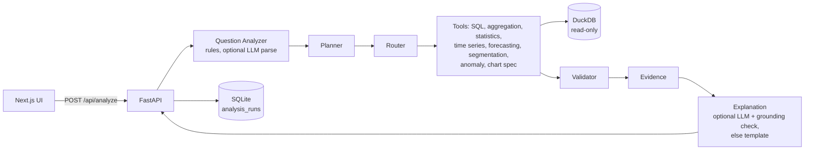

# ABI Analyst: an Autonomous Business Intelligence Analyst (Phase 1)

A question-answering analyst for two years of online-retail sales. You ask a business question in plain English
("Which region grew fastest?", "What products drove that growth?"); the backend turns it into a validated analysis
plan, runs SQL and Python tools on a read-only DuckDB database, checks the results, and returns an answer with the
evidence, a chart, the SQL it ran and its limitations.

**The language model never computes numbers.** SQL and Python compute everything. OpenAI is optional and is used for
two things only: parsing a question the rule-based parser is unsure about, and wording the explanation. Every number
in an AI-written explanation must match a number in the computed evidence, or the app falls back to a deterministic
template.

Built as a Data Science portfolio project. Phase 1 runs locally only.

## Features

- Questions answered: revenue rankings, totals, period-over-period growth, change decomposition and drivers, top-N
  products, monthly trends, 7-90 day forecasts, anomaly detection with drill-down, RFM customer segments, synthetic
  campaign comparisons, two-group significance tests, chi-square association, price-units correlation.
- Follow-up questions in the same conversation ("What products drove that growth?", "What about Germany?").
- No-answer mode for questions the data cannot answer (weather, 2-year forecasts, instructions to ignore rules).
- UI: answer, evidence, analysis and limitations; chart; View SQL / View Data / View Method toggles; data lineage;
  follow-up chips; a collapsible Analysis Trace; recent and saved analyses; a methodology page.

## Architecture



## Agent workflow

1. **Understand**: deterministic parser for known question shapes; OpenAI structured output (fixed Pydantic schema)
   only when the parser is not confident. LLM output is validated against known intents, metrics and entity names.
2. **Plan**: typed plan of tool calls (code, not free text).
3. **Execute**: router calls registered tools only. No shell, file-system or code-execution tools exist.
4. **Validate**: non-empty, finite, group totals reconcile with an independent total, periods within the data range.
5. **Evidence**: headline numbers, supporting rows, SQL, periods, limitations.
6. **Explain**: OpenAI or template; grounding check on numbers, product names and causal wording.

At most two OpenAI calls per question.

## Dataset

[UCI Online Retail II](https://archive.ics.uci.edu/dataset/502/online+retail+ii) (Chen, 2019), licence CC BY 4.0:
1,067,371 invoice lines from a UK online gift retailer, 2009-12-01 to 2011-12-09. After cleaning, 1,003,214 sales
lines remain. Regions and product categories are derived by rules; campaigns are **synthetic** (seed 42, no effect
injected). Details and the data dictionary: [data/README.md](data/README.md).

## Database schema

DuckDB star schema: `sales` (fact, one row per invoice line), `products`, `customers`, `regions`, `calendar`,
`campaigns` (synthetic), `cancellations`. Queries use standard SQL that also runs on PostgreSQL (no DuckDB-only
syntax in the query compiler).

## Tools and methods

| Tool | Methods |
|---|---|
| SQL query | Typed spec compiled to parameterised SELECT; safety layer |
| Aggregation | Top-N with shares, growth with small-base flag (<1% of comparison total), change decomposition |
| Statistics | Shapiro-Wilk + Levene, then Student / Welch t or Mann-Whitney U; 95% CI, Cohen's d; chi-square + Cramér's V; Pearson (log-log, Fisher CI) and Spearman |
| Time series | Monthly trend |
| Forecasting | Seasonal naive (lag 7), 4-week weekday mean, ridge regression (trend + weekday + annual Fourier); holdout of the last *h* days; MAE / RMSE; best model used, baseline if nothing beats it; max 90 days |
| Segmentation | RFM, log1p + standardisation, K-Means k = 2-6 chosen by silhouette |
| Anomaly | Trailing 28-trading-day median / MAD robust z (> 3.5) with IQR cross-check; drill-down by region, product, order; cancellation check |
| Chart spec | Declarative bar / area / line / box / heatmap / scatter specs rendered with Recharts |

Measured 30-day forecast holdout (2011-11-09 to 2011-12-08): seasonal naive MAE £12,678 (RMSE £16,127), weekday mean
MAE £13,340, ridge MAE £16,022. Nothing beat the baseline, so the baseline is used and the app says so.

## SQL safety

One `validate_sql` gate for every query: single statement parsed with sqlglot, `SELECT` only, keyword blocklist after
removing string literals, table and column allowlists, no schema-qualified names or table functions, function
blocklist, LIMIT enforced and capped. The DuckDB connection is read-only with `enable_external_access=false` and a
locked configuration, and queries are interrupted after a timeout. The LLM never writes SQL.

## Prompt-injection protection

- Question screens for instructions such as "ignore previous instructions" or requests to change data.
- Evidence text (product descriptions, the question) is passed to the LLM as data with an explicit rule to ignore
  instructions inside it.
- Grounding check: numbers that appear only inside data strings do not count as evidence, unknown upper-case product
  names are rejected, and causal wording is rejected for observational analyses.
- Tests plant a product description containing "Ignore previous instructions…" and check it cannot change the answer.

## Evaluation

`scripts/run_eval.py` runs 18 questions from `evals/questions.yaml` with and without OpenAI. Ground truth is
recomputed independently with pandas from the raw file. Results: [docs/evaluation_report.md](docs/evaluation_report.md).

## Running locally (bash)

Tested on Linux with Python 3.13 and Node 20.

```bash
python -m venv .venv && source .venv/bin/activate
pip install -r backend/requirements-dev.txt
python scripts/run_pipeline.py            # downloads/copies the dataset and builds data/processed/abi.duckdb

# backend (OpenAI optional: set OPENAI_API_KEY or OPENAI_KEY_FILE in your shell)
cd backend && uvicorn app.main:app --port 8000

# frontend (second terminal)
cd frontend && npm install && npm run dev  # http://localhost:3000
```

Checks:

```bash
cd backend && pytest -q && cd .. && ruff check backend scripts
cd frontend && npm run lint && npx tsc --noEmit && npm run build
python scripts/run_eval.py --modes template,openai
```

## Running locally (PowerShell): NOT TESTED

```powershell
python -m venv .venv; .\.venv\Scripts\Activate.ps1
pip install -r backend\requirements-dev.txt
python scripts\run_pipeline.py
cd backend; uvicorn app.main:app --port 8000
# second terminal
cd frontend; npm install; npm run dev
```

## Environment variables

See [.env.example](.env.example). Names only: `OPENAI_API_KEY`, `OPENAI_KEY_FILE`, `OPENAI_MODEL` (default
`gpt-4o-mini`), `OPENAI_TIMEOUT_S`, `ABI_DISABLE_OPENAI`, `CORS_ORIGINS`, `ABI_DB_PATH`, `ABI_RUNS_DB_PATH`,
`SQL_MAX_ROWS`, `SQL_TIMEOUT_S`, `ABI_RAW_XLSX` (pipeline), `NEXT_PUBLIC_API_BASE_URL` (frontend). The OpenAI key is
read by the backend only and is never sent to the browser.

## API

`POST /api/analyze` · `GET /api/runs` · `GET /api/runs/{id}` · `GET /api/schema` · `GET /api/suggestions` · `GET /health`.
Errors are returned as `{"error": {"code", "message"}}` without stack traces.

## Project structure

```
backend/   FastAPI app: agent/ (analyzer, planner, router, evidence, grounding), tools/, database/, ai/, services/; tests/
frontend/  Next.js app (src/app, src/components, src/lib)
scripts/   ingest.py, build_db.py, run_pipeline.py, run_eval.py
evals/     questions.yaml (results/ is git-ignored)
data/      README.md; raw/ and processed/ are git-ignored
docs/      evaluation_report.md
```

## Limitations

- One public dataset from a single UK retailer, 2009-2011; no costs, margins or marketing spend.
- Regions and categories are rule-derived; campaigns are synthetic, so campaign results only demonstrate the method.
- The rule-based parser covers a fixed set of question shapes; other phrasing depends on the optional LLM parser.
- Conversation memory is in-process (lost on restart).
- Results are observational. Forecasts are point estimates from about two years of history.
- The evaluation set was written by the developer alongside the system and is small (18 questions).

## Roadmap (Phase 2 ideas)

See the end of [PROJECT-CONTEXT.md](PROJECT-CONTEXT.md).

## Credits

Data: Chen, D. (2019). Online Retail II [Dataset]. UCI Machine Learning Repository. https://doi.org/10.24432/C5CG6D (CC BY 4.0).
