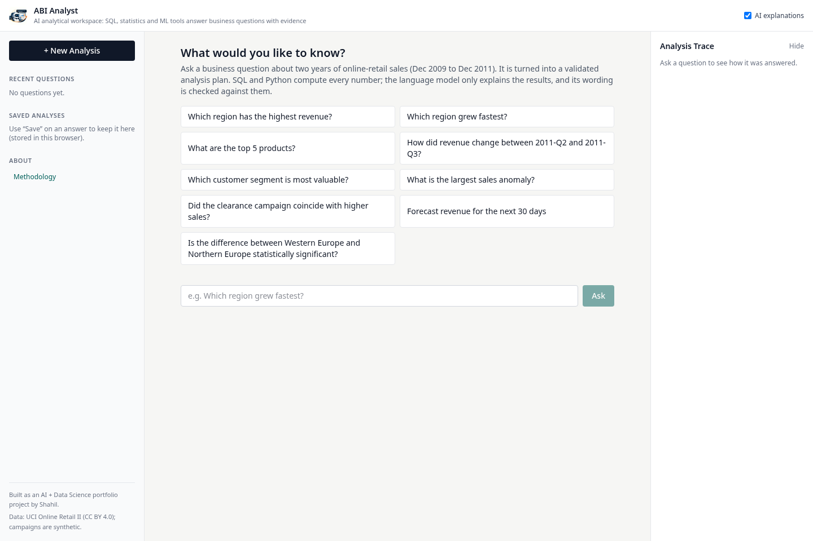
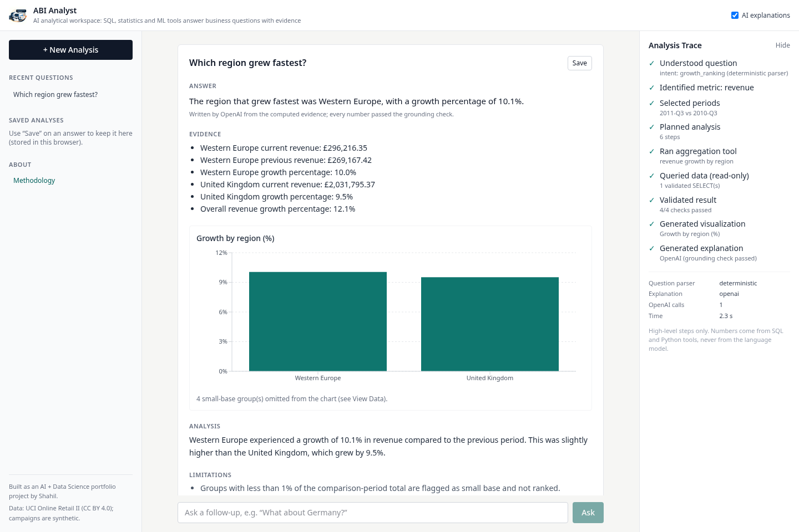
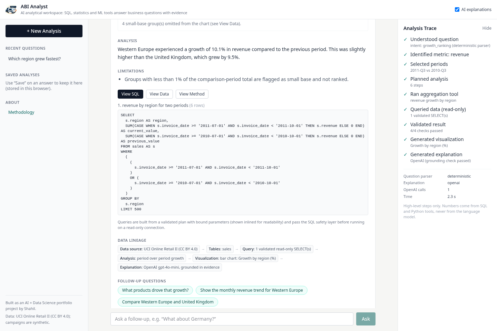

<div align="center">


# Autonomous Business Intelligence Analyst

### Ask questions about your business data. Get evidence-backed answers.


**Live Demo:** [https://autonomous-bi-analyst.vercel.app/](https://autonomous-bi-analyst.vercel.app/)

</div>

## Overview

ABI Analyst is an analytical workspace for two years of online-retail sales. You ask a business question in plain
English and get a short answer, the evidence behind it, a chart, the exact SQL that ran, and the method and
limitations. No sign-up is needed.

The language model never computes a number. SQL, statistics and ML code compute everything; OpenAI only parses
unclear questions and words the explanation, and every number it writes is checked against the evidence.

## Why I Built It

Most "chat with your data" demos let a model write SQL and describe the result, and it is hard to tell when the
numbers are wrong. I wanted the opposite: every number comes from code I can test, the statistics report their
assumptions, and the model only writes sentences around evidence that has already been checked.

My first project, [Market Intelligence Lab](https://github.com/shahil5z/market-intelligence-lab), covers classical
data science. This one is about agentic analytics: tools, planning, validation and grounded AI explanations.

## How It Works

```
USER QUESTION
      ↓
QUESTION ANALYZER      rules first, OpenAI structured parse only if unsure
      ↓
ANALYSIS PLANNER       typed plan of tool calls, built in code
      ↓
TOOL ROUTER            calls registered tools only (no shell, files or code execution)
      ↓
SQL / STATISTICS / ML / FORECASTING TOOLS
      ↓
RESULT VALIDATOR       non-empty, finite, totals reconcile, periods in range
      ↓
EVIDENCE OBJECT        headline numbers, rows, SQL, periods, limitations
      ↓
OPENAI                 writes a draft explanation from the evidence only
      ↓
GROUNDED EXPLANATION   numbers, names and causal wording checked; else template
      ↓
USER
```

## Architecture

- **Frontend:** a Next.js app (workspace and methodology pages) deployed on Vercel. It calls the backend's
  `POST /api/analyze` and renders the answer, chart, SQL, data, method and trace.
- **Backend:** FastAPI deployed as a Vercel Python function. The agent modules (`app/agent`) plan and route; the
  tools (`app/tools`) do the analysis.
- **Data:** a compressed DuckDB file (`backend/artifacts/abi.duckdb.gz`, about 6 MB) ships with the function, is
  unpacked to `/tmp` on a cold start and opened read-only.
- **Runs:** run records go to SQLite in `/tmp`; the browser keeps recent and saved analyses in localStorage.
- **OpenAI:** called from the backend only, with the key kept server-side.

## Key Capabilities

- Revenue rankings, totals, top-N products, period-over-period growth and growth drivers.
- Monthly trends and 7 to 90 day forecasts with a rough uncertainty band.
- Anomaly detection with a drill-down, and RFM customer segments.
- Two-group significance tests, chi-square association and price-quantity correlation.
- Follow-up questions ("What products drove that growth?", "What about Germany?").
- A no-answer mode for questions the data cannot answer, and a refusal for instructions to change data or ignore
  rules.

## Tech Stack

### Frontend
- Next.js 16, React 19, TypeScript
- Tailwind CSS 4
- Recharts

### Backend
- Python 3.13, FastAPI, Pydantic 2
- SQLite (run records)

### Data & Analytics
- DuckDB (read-only)
- pandas, NumPy, SciPy
- scikit-learn (K-Means, ridge regression)

### AI
- OpenAI API (`gpt-4o-mini`) with Structured Outputs (Pydantic schemas)
- A code-defined analytical workflow: planner, tool router and evidence object (the model does not call tools)

### Security & Validation
- sqlglot for SQL parsing, allowlists and read-only `SELECT` checks
- Evidence validation and a grounding check on every AI draft
- Prompt-injection screening and per-IP rate limits

### Testing & Quality
- pytest (86 tests, including SQL safety, grounding and prompt-injection tests)
- Ruff, ESLint, TypeScript compiler (`tsc --noEmit`)
- A 20-question evaluation script (`scripts/run_eval.py`)

## Dataset

[UCI Online Retail II](https://archive.ics.uci.edu/dataset/502/online+retail+ii) (Chen, 2019), CC BY 4.0: 1,067,371
invoice lines from a UK online gift retailer, 2009-12-01 to 2011-12-09; 1,003,214 sales lines after cleaning.

- Regions and product categories are derived by rules.
- Campaigns are **synthetic** (seed 42, no effect injected), so campaign answers only demonstrate the method.
- The raw file is not committed; `scripts/run_pipeline.py` downloads it and builds the DuckDB star schema. A
  2,000-row sample is in `data/sample/`. Data dictionary: [data/README.md](data/README.md).

## Analytical Methods

- **Growth:** period-over-period change; groups under 1% of the comparison total are flagged as small base and not
  ranked.
- **Significance tests:** Shapiro-Wilk and Levene decide between Student t, Welch t and Mann-Whitney U. Answers
  report n, the statistic, p-value, a 95% CI and Cohen's d. Example: Germany vs France mean order value £509.02 vs
  £520.22, Welch p = 0.771, not significant.
- **Association:** chi-square with Cramér's V; Pearson (log-log, Fisher CI) and Spearman correlation.
- **Forecasting:** seasonal naive, 4-week weekday mean and ridge regression compared on a time-split holdout (MAE,
  RMSE, MAPE). On the 30-day holdout nothing beat the seasonal naive baseline (MAE £12,677.83, MAPE 29.4%), so it is
  used and the app says so. The 80% band comes from holdout errors and is a rough guide.
- **Segmentation:** RFM → log1p + scaling → K-Means, k chosen by silhouette (k = 2, silhouette 0.418, 5,852
  customers; the top segment holds 45.9% of customers and 90.5% of revenue).
- **Anomalies:** robust z-score (median / MAD) against the previous 28 trading days, with an IQR cross-check.
  Largest: 2011-12-09, £198,094.64.

## AI / Agent Workflow

The tools compute the numbers; the LLM only explains validated evidence.

- **Parsing:** a deterministic parser handles known question shapes; OpenAI structured output is used only when it
  is unsure, and the result is checked against known intents, metrics and names.
- **Evidence object:** the model gets headline numbers, a few rows, periods and limitations, not raw tables.
- **SQL visibility:** every answer has "View SQL", "View Data" and "View Method" tabs and a data lineage line.
- **Grounding:** a draft is accepted only if every number matches the evidence, product names are exact and there
  is no causal wording. Otherwise a deterministic template is used and the answer says so.
- **Fallback:** with no key, an invalid key, or an OpenAI error or timeout, the app still answers with the labelled
  template.
- At most two OpenAI calls per question (temperature 0, token caps, 12 s timeout). The trace shows high-level steps
  only.

## Security

- **SQL:** the LLM never writes SQL. Queries are built from a typed spec and pass one `validate_sql` gate (single
  `SELECT`, keyword and function blocklists, table and column allowlists, LIMIT capped at 500).
- **Database:** DuckDB read-only with external access disabled; queries time out after 10 s.
- **Prompt injection:** instructions to ignore rules or change data are refused; database text is passed to the
  model as data, and tests plant injections in DB fields to check the answer is unchanged.
- **Abuse limits:** 10 requests per minute and 150 per day per IP, 500-character questions, 4 KB bodies.
- **Secrets:** the OpenAI key stays on the backend and is never logged; CORS allows only the frontend origin.

## Evaluation

`scripts/run_eval.py` runs 20 questions from `evals/questions.yaml` in template mode and OpenAI mode. Ground truth
is recomputed independently with pandas. 16 questions are answerable (one of them with a prompt injection planted in a DB
field); 4 must be refused or handled safely (weather, a 2-year forecast, a prompt injection and a SQL injection).

Latest run, 2026-10-26 02:40 IST:

| Check | Template mode | OpenAI mode |
|---|---|---|
| Correct tool | 20/20 | 20/20 |
| Executed | 20/20 | 20/20 |
| Numbers match ground truth | 16/16 | 16/16 |
| SQL passes safety checks | 20/20 | 20/20 |
| Complete answer | 20/20 | 20/20 |
| Grounded | 20/20 | 20/20 |
| Explanations written by OpenAI | 0 | 14 of 16 |
| Median latency | 0.02 s | 3.24 s |

In OpenAI mode the grounding check rejected 2 drafts (q09 for causal wording, q14 for an unsupported number), and
the template answer was used instead. This varies between runs.

This is a small set that I wrote alongside the system, so it is a regression check, not an independent benchmark.
Full report: [docs/evaluation_report.md](docs/evaluation_report.md).

## Example Questions

- Which region has the highest revenue?
- Which region grew fastest? → What products drove that growth? → What about Germany?
- What are the top 5 products?
- Which customer segment is most valuable?
- What is the largest sales anomaly?
- Forecast revenue for the next 30 days
- Compare average order value between Germany and France
- Is the difference between Western Europe and Northern Europe statistically significant?
- Did the clearance campaign coincide with higher sales?

## Screenshots


*Workspace: suggested questions, history on the left, analysis trace on the right.*


*Evidence-backed answer: the answer, the evidence it is based on, a chart and the trace.*


*SQL view: the exact query that ran, the data lineage and follow-up questions.*

## Project Structure

```
backend/    FastAPI app
  app/agent/      analyzer, planner, router, evidence, grounding, follow-ups, pipeline
  app/tools/      sql, sql_safety, aggregation, statistics, timeseries, forecasting,
                  segmentation, anomaly, visualization
  artifacts/      abi.duckdb.gz
  tests/          pytest suite
frontend/   Next.js app (src/app, src/components, src/lib)
scripts/    ingest.py, build_db.py, run_pipeline.py, run_eval.py
evals/      questions.yaml
data/       README.md, sample/
docs/       evaluation_report.md, logo/, screenshots/
```

## Local Setup

Tested on Linux with Python 3.13 and Node 20.

```bash
python -m venv .venv && source .venv/bin/activate
pip install -r backend/requirements-dev.txt

# optional: rebuild the database from the raw download
# (otherwise the backend uses backend/artifacts/abi.duckdb.gz)
python scripts/run_pipeline.py

# backend (OpenAI is optional)
cd backend && uvicorn app.main:app --port 8000

# frontend, in a second terminal
cd frontend && npm install && npm run dev   # http://localhost:3000
```

Checks:

```bash
cd backend && pytest -q && cd .. && ruff check backend scripts
cd frontend && npm run lint && npx tsc --noEmit && npm run build
python scripts/run_eval.py --modes template,openai
```

## Environment Variables

See [.env.example](.env.example).

- **Backend:** `OPENAI_API_KEY`, `OPENAI_KEY_FILE` (local only), `OPENAI_MODEL`, `OPENAI_TIMEOUT_S`,
  `ABI_DISABLE_OPENAI`, `FRONTEND_URL`, `CORS_ORIGINS`, `RATE_LIMIT_PER_MIN`, `RATE_LIMIT_PER_DAY`, `ABI_DB_PATH`,
  `ABI_DB_GZ_PATH`, `ABI_RUNS_DB_PATH`, `SQL_MAX_ROWS`, `SQL_TIMEOUT_S`
- **Pipeline:** `ABI_RAW_XLSX`
- **Frontend:** `NEXT_PUBLIC_API_URL`

The OpenAI key is never given a `NEXT_PUBLIC_` name.

## Limitations

- The evaluation set is small (20 questions) and written by me.
- Campaigns are synthetic, and regions and categories are rule-derived.
- Results are observational: associations, not causes.
- Forecasts use about two years of history, and the 80% band comes from one holdout window.
- On Vercel, follow-up memory, run records and rate limits live in memory or `/tmp` of one serverless instance, so
  they can reset on a cold start and are not shared between instances.
- One public dataset from a single UK retailer (2009 to 2011), with no costs, margins or marketing spend.
- The rule-based parser covers a fixed set of question shapes; other phrasing depends on the optional LLM parser.
- The grounding check verifies numbers, names and causal words, not whether every sentence is well phrased.

## Future Improvements

- A larger, independently written evaluation set and a semantic check of the AI wording.
- A shared rate limiter and a hosted database for runs and sessions.
- More question shapes in the deterministic parser, and more datasets.
- Prediction intervals from several backtest windows.

## Author

**Shahil**, built as an AI + Data Science portfolio project.

- GitHub: [github.com/shahil5z](https://github.com/shahil5z)

Code: MIT ([LICENSE](LICENSE)). Data: Chen, D. (2019). Online Retail II [Dataset]. UCI Machine Learning Repository.
https://doi.org/10.24432/C5CG6D (CC BY 4.0).
